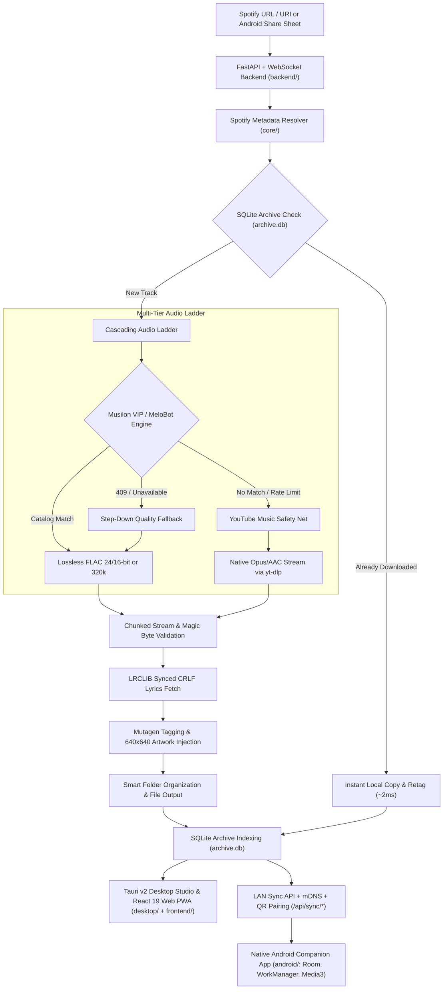

# Flacify — High-Fidelity Audio Studio

<p align="center">
  <br>
  <strong>Flacify v2.1.0 — Tauri v2 Desktop App, Resizable Studio Mini Player, Wi-Fi Mobile Sync, Android Companion & 10-Band EQ</strong><br><br>
  <a href="https://github.com/younes-qasempour/Spotify_downloader/releases"></a>
  
  
  
  
  
  
</p>

---

## ✨ Flacify v2.1.0 Architecture & Quick Start

Flacify v2.1 pairs the proven **pure-Python `core/` engine** with a thin **FastAPI + WebSocket backend (`backend/`)**, a modern **React 19 + TypeScript + Tailwind CSS v4 frontend (`frontend/`)**, a **Tauri v2 Windows desktop shell (`desktop/`)**, and a **native Kotlin + Jetpack Compose Android companion app (`android/`)**:

- **Windows Desktop App (`desktop/`):** Run `Flacify_Setup_v2.1.0.exe` or launch dev mode via `cd desktop && npm.cmd run dev` (frameless Windows 11 window, native folder/file dialogs, system tray, automatic backend sidecar lifecycle).
- **Wi-Fi/LAN Mobile Sync & Native Android Companion App (`android/`):** Pair via QR code or mDNS (`_flacify._tcp.local.`), run resumable lossless FLAC offline playlist sync (`Flacify_Android_v2.1.0.apk`), play offline tracks with Media3 and synced lyrics, and share Spotify links directly to your PC queue. See [`android/README.md`](android/README.md) for mobile build and pairing details.
- **Resizable Studio Mini Player (`Alt+M`):** Detachable floating PiP / native always-on-top window with 8-direction free resizing across 3 adaptive layouts (**Micro Strip**, **Art Card**, **Studio Deck**), live 60fps FFT spectrum visualizer, synced karaoke lyrics + translation, Up Next queue switching, and Quick EQ.
- **Production Web Mode & PWA (`python -m backend`):** Serve the full UI locally or over your LAN/phone at any browser:
  ```powershell
  python -m backend --host 0.0.0.0 --port 8765 --open
  ```
- **Build v2.1.0 Desktop Bundle + Installer:**
  ```powershell
  python build_v2.py
  ```
- **Legacy v1.x PyQt6 GUI & Headless CLI:** Preserved in `main.py` (`python main.py` / `python main.py --headless "<spotify_url>"`).

---

## 📖 Overview

**Flacify** is a multi-platform **Windows 11 Desktop Studio, Web PWA, Headless CLI, and Native Android Companion** engineered to archive Spotify tracks, albums, and massive playlists (1,000+ tracks) at **true studio-master fidelity** without crashes, rate-limit bans, audio transcoding artifacts, or duplicate storage bloat.

Unlike conventional downloaders that record compressed, lossy audio or re-encode degraded streams, Flacify combines **direct high-speed lossless CDN retrieval** with **stealth anti-ban pacing**, **exact ISRC matching**, **embedded CRLF synchronized lyrics**, an **offline SQLite library manager**, and **zero-transcode Wi-Fi FLAC sync to Android**.

Built on a **decoupled multi-layer architecture**:
- **Headless Multimedia Engine (`core/`):** Multi-threaded Python core with zero UI dependencies.
- **FastAPI + WebSocket + LAN Sync Server (`backend/`):** Thin async REST, range-streaming media, WebSocket event bus, mDNS broadcaster, and mobile sync API.
- **Modern Studio Web UI (`frontend/`):** React 19 + TypeScript + Tailwind CSS v4 frontend with Web Audio 10-band EQ and virtualized views.
- **Windows Desktop Shell (`desktop/`):** Tauri v2 native window, system tray, and automatic `flacify-backend.exe` sidecar management.
- **Native Android Companion (`android/`):** Offline-first Kotlin + Jetpack Compose app with Room storage, WorkManager resumable sync, Media3 lossless playback, QR pairing, and Android Share Sheet integration.
- **Preserved Legacy Fluent GUI (`gui/`):** Original PyQt6 / PyQt6-Fluent-Widgets desktop presentation layer preserved in `main.py`.

---

## 🌟 Key Features

### 📱 Wi-Fi/LAN Mobile Sync & Native Android Companion (v2.1.0)
- **QR Code & Automatic mDNS Discovery (`_flacify._tcp.local.`):** Pair Android phones from **Settings → Mobile Sync** via one-scan CameraX + ZXing QR pairing, local Zeroconf service discovery, or direct URL/token entry (including emulator `10.0.2.2:8765` support).
- **Resumable Lossless FLAC Transfer:** Dedicated `WorkManager` + `ResumableFileDownloader` streams original bit-perfect `.flac` audio, embedded/LRC synced lyrics, and album cover art over LAN using `ETag` and HTTP `Range` / `If-Range` resume.
- **Offline Room Library & Media3 Player:** Browse offline playlists and searchable tracks backed by Room SQLite, and play bit-perfect audio completely offline via Media3 (`ExoPlayer` + background `MediaSessionService`) with seekable synced lyrics, queue management, and a persistent mini player bar.
- **Android Share Sheet to PC (`Send to Flacify PC`):** Share any Spotify track, album, playlist, or `spotify.link` / `spoti.fi` URL from Spotify or a mobile browser directly into your PC download queue, with a local retry queue when off your home network.
- **Hardened LAN Security & High-Speed Manifest:** Bearer token authentication for LAN clients, loopback-only restrictions for local host controls (`open-folder`, LRC file paths, pairing QR, token regeneration, and API docs), SSRF-safe short-link unwrapping, and gzip-compressed `os.scandir()` manifest generation (~450 ms over 5,500+ tracks).

### 🖥️ Tauri v2 Desktop Studio, Web PWA & Studio Mini Player (v2.0.0 – v2.0.1)
- **Frameless Tauri v2 Desktop App:** Native Windows 11 window chrome, single-instance focus, tray menu with Mini Player toggle, native folder/file dialogs, and bundled PyInstaller FastAPI sidecar.
- **Resizable Studio Mini Player (`Alt+M`):** Detachable floating window / web deck across three responsive tiers (**Micro Strip**, **Art Card**, **Studio Deck**) with 60fps FFT spectrum visualizer, synced karaoke lyrics with inline translation, Up Next queue switching, and Quick EQ.
- **Modern React 19 Studio Workspace:** Real-time WebSocket progress streaming (`QueuePage`), saved playlists & auto-sync (`PlaylistsPage`, `PlaylistDetailPage`), virtualized offline library (`LibraryPage`), 10-band Web Audio EQ, Audio Spectrum Inspector & Duplicate Merger (`ToolsPage`), and Mobile Sync / Source settings (`SettingsPage`).
- **Single-Folder Library Deduplication:** Enforces clean single-folder storage (`save_in_subfolders` toggle) and deduplicates overlapping remasters across saved playlists while keeping all track mappings intact.

### 🎛️ High-Density UI & Collapsible Batch Controls (v1.6.1)
- **High-Density Track Layout:** Optimized table item height to 56px and cover art to 40x40 with crisp typography, fitting 10+ songs on screen without vertical scrolling.
- **Collapsible Batch Download Drawer:** Replaced bulky configuration blocks with a sleek, space-saving expandable drawer (`Batch Options ▾`) featuring instant batch presets (25, 50, 100, 200, All Pending) and custom spinbox controls.
- **Unified Single-Row Action Headers:** Consolidated search bars, playlist controls, and library statistics into compact, clean 32-50px headers across all views.
- **Compact 72px Player Bar:** Slimmed docked audio player dock to maximize screen real estate while retaining full scrubbing and playback capabilities.

### 🏛️ Centralized Master Library & Zero Duplication (v1.6.0)
- **Central Master Directory:** All downloads route into a consolidated repository (`downloads/`).
- **Zero-Duplication Virtual Playlists:** Songs shared across multiple Spotify playlists are downloaded exactly once and shared virtually.
- **Smart Remaster & Punctuation Deduplication:** Automatically consolidates alternative album issues (e.g. *Remastered*, *Deluxe Edition*, *2011 Mix*) to save gigabytes of disk space while keeping all playlists linked.

### 📦 Multi-Device Track & Playlist Exporter (v1.6.0)
- **Portable Song Exporter:** Easily export any playlist or selection to external USB drives, car stereos, or portable DAPs with optional on-the-fly transcoding to MP3 (320 kbps CBR via FFmpeg), FLAC, or Opus.
- **Multi-Platform `.m3u8` Playlist Exporter:** Generates lightweight playlist files preserving exact original Spotify track sequence:
  - **Android Universal:** Filename-only matching (`Song.flac`) recognized automatically by Poweramp, Musicolet, GoneMAD, and VLC Android.
  - **Windows PC:** Absolute paths for VLC, PotPlayer, KMPlayer, and Foobar2000 with instant *"Play in Default Player"* launch.

### 🤖 MeloBot Telegram Integration & FastTelethon Acceleration (v1.5.2)
- **10x Faster Downloads & Direct MTProto Streaming:** Upgraded download pipeline with optimized MTProto routines and native crypto acceleration (`cryptg`), speeding up candidate search and media transfers by up to 10x via `@melobot`.
- **FloodWait Elimination via Push-Event Navigation:** Replaced high-frequency polling with native Telethon push updates (`events.NewMessage` and `events.MessageEdited`), completely preventing `FloodWaitError` rate-limiting.
- **Deduplicated Multi-Click Retries:** Tracks button message IDs to prevent duplicate clicks and retries unacknowledged clicks up to 3 times at 5s intervals within an adaptive 45s delivery window.
- **Strict Quality Enforcement & Genuine Badges:** Rejects unwanted 128 kbps standard files when high/lossless quality is requested, verifies physical on-disk bitrates before tagging, and displays dedicated emerald lossless badges for `MeloBot FLAC`.
- **Intelligent Bot Interactive Keyboard Navigation:** Automatically negotiates multi-step Telegram bot dialogs—detects search candidates, navigates album menus, rejects promotional/navigation buttons, and selects optimal audio quality tiers (FLAC > 320k > 128k).
- **Single-Song Serialized Concurrency Guard:** Automatically serializes Telegram bot queries to 1-at-a-time while allowing parallel local processing, preventing bot flood limits and chat state collisions.
- **Dedicated Telegram Settings & Auth Flow:** Connect your Telegram account directly from the Fluent Settings interface via an interactive, secure two-step login modal (phone number -> SMS/App code -> 2FA password).

### 🎼 Classical & Multi-Part Aria Search Engine (v1.5)
- **Automatic Classical Detection:** Identifies classical and opera works across all eras (Mozart, Bruckner, Beethoven, Bach, Vivaldi, etc.) via catalog numbers (`Op`, `WAB`, `BWV`, `Hob`, `K`, `RV`) and composition terminology (`Symphony`, `Concerto`, `Sonata`, `Scherzo`, `Aria`, `Canzonetta`).
- **Clean Movement & Aria Extraction:** Automatically strips complex 100+ character Spotify titles down to core movement and aria phrases across colons, hyphens, and ellipses (`...`), preventing search engine query bloat.
- **Adaptive Classical Duration Tolerance:** Expands duration matching to $\max(45.0\text{s}, \text{target\_dur} \times 0.15)$ with gentle penalty slopes, accommodating natural tempo variations between different conductors and orchestras.
- **Topic Channel Verification:** Accurately verifies performer-named Topic channels without false "Foreign topic channel" rejections.

### 🎧 High-Fidelity Cascading Audio Ladder
Every queued track automatically traverses an intelligent cascading resolution ladder to guarantee the highest acoustic fidelity available:
1. **Tier 1 (Target):** **Musilon Studio Master 24-bit Hi-Res FLAC** (48 kHz – 96 kHz / 24-bit PCM) or **MeloBot Lossless FLAC**.
2. **Tier 2 (Lossless):** **Musilon CD-Quality 16-bit FLAC** (44.1 kHz / 16-bit Lossless).
3. **Tier 3 (Pristine):** **Musilon / MeloBot Studio 320 kbps MP3** (Constant Bitrate, 320 kbps).
4. **Tier 4 (Safety Net):** **YouTube Music native Opus/AAC** stream via `yt-dlp` with strict duration validation. *Engages automatically if a song is not indexed on lossless CDNs.*

### 🔍 Precision Catalog Matching & Anti-False-Positive Heuristics
- **Exact ISRC Resolution:** Matches tracks against International Standard Recording Codes (ISRC) for instant 100% verified track matching.
- **Dynamic Context Inspection:** Queries live track metadata via `/api/tracks/{id}/context` to detect bit depth, sample rates, and available audio tiers.
- **Anti-False-Positive Scoring:** Enforces strict artist validation, penalizes foreign artist uploads (`-999.0`), and penalizes unrequested remixes, karaoke, live versions, and tribute covers.
- **Quality Step-Down Fallback:** Seamlessly handles HTTP 409 (`DOWNLOAD_QUALITY_UNAVAILABLE`) by stepping down from 24-bit to 16-bit or 320k without download failures.

### 🛡️ VIP Integration & Stealth Anti-Ban Shield
- **Direct Credentials Authentication:** Seamless login via NextAuth Directus flow using your registered Musilon email and password with automatic session renewal.
- **Real-Time Download Budget Diagnostics:** Queries `/api/media/download-budget` live to track your daily quota (150 Lossless / 150 Standard songs/day) directly within the UI.
- **Single-Stream CDN Mutex:** Restricts concurrent CDN streaming to 1 active connection while allowing YouTube Music and local deduplication to operate in parallel.
- **Human Jitter & Cooldown Countdown:** Enforces randomized pacing (15–35s) with a live UI countdown timer (`VIP Cooldown (18s)`) and non-blocking cancellation.
- **Pause-and-Prompt On Limit:** If daily limits or rate-limits are reached, the app cleanly pauses and prompts you with options to switch to YouTube Music or gracefully stop.

### 📜 Synchronized CRLF Lyrics & Audio Tagging
- **Embedded Synchronized Lyrics:** Automatically fetches synchronized time-stamped lyrics from LRCLIB and embeds them directly into Vorbis comments (`LYRICS`, `UNSYNCEDLYRICS`) and ID3 (`USLT`).
- **Windows CRLF Formatting:** Standardizes all lyrics line breaks to Windows CRLF (`\r\n`), ensuring seamless scrolling in desktop players like foobar2000, Windows Media Player, MusicBee, and AIMP.
- **High-Resolution Front Cover Artwork:** Injects authentic 640×640 album artwork directly from Spotify's CDN into FLAC picture blocks, ID3 APIC frames, and MP4 cover atoms.
- **Watermark Scrubbing:** Automatically strips promotional site watermarks (e.g. `[Musilon]`, `- musilon.com`) from metadata tags and filenames.

### 📁 Smart Folder Organization & Track Numbering
- **Playlists:** Saved to `{output_dir}/{playlist_name}/` (or directly in `{output_dir}/` when `save_in_subfolders` is disabled).
- **Albums:** Saved to `{output_dir}/{album_name}/` with album track numbering (`01. Artist - Title.flac`), preserving genuine track and disc order.
- **Singles:** Standalone tracks are neatly routed to `{output_dir}/Singles/`.
- **Isolated App Cache:** Album covers and marker files are stored in `%LOCALAPPDATA%\Flacify\cache`, leaving your music folders 100% clean.

### 💾 Offline Saved Playlists & Differential Sync
- **Metadata Archiving:** Import massive playlists (500 to 5,000+ tracks) and save their full track listings instantly into a local SQLite database without queuing audio downloads.
- **Flexible Batch Downloading:** Download tracks in custom batches (25, 50, 100, 200, or custom size) with a single click, keeping you comfortably under daily quota limits.
- **Persistent Progress Tracking:** Visual progress bars, track counters (Total, Downloaded, Pending), and track-level status badges (`Pending`, `Queued`, `Completed`).
- **Differential Playlist Synchronization:** Single-click incremental synchronization compares online Spotify playlists against local database storage, purges deleted tracks, and automatically enqueues newly added delta tracks directly into the download queue with live notifications.
- **Freeze-Free Queue Ingestion:** Vectorized batch model insertions eliminate UI freezes when enqueuing thousands of tracks simultaneously.

### 🎧 Dynamic Audio Device Switching & Universal Keyboard Controls (v1.4.2)
- **Automatic Audio Output Migration:** Dynamically tracks Windows default playback endpoint changes. Switching default devices in Windows (plugging in earphones, connecting Bluetooth headphones, or changing the taskbar sound output) immediately migrates the audio stream without restarting the application or stopping playback.
- **Audio Output Device Picker:** Dedicated audio device button (`FluentIcon.HEADPHONE`) on the mini-player bar displays a quick menu to choose between "System Default (Auto-Switch)" or any specific connected sound device.
- **Universal Keyboard Controls:** Space (Play/Pause), Left/Right arrows (Seek -5s / +5s, Shift for 10s), Ctrl+Left/Right (Previous/Next track), Up/Down arrows (Volume), and hotkeys (J/K/L/M/N/P) work everywhere across the app.
- **Smart Text-Input Isolation:** Normal typing in search inputs, URLs, playlist rename dialogs, or tag editor dialogs is completely protected and never hijacked.
- **Windows Media Hardware & Headset Integration:** Full support for dedicated multimedia keyboard keys and Bluetooth headset buttons via `WM_APPCOMMAND` and Windows global media hotkeys (`VK_MEDIA_PLAY_PAUSE`, `VK_MEDIA_NEXT_TRACK`, etc.).

### ✏️ Manual Playlist Renaming & Metadata Customization (v1.4.1)
- **Manual Playlist Renaming:** Rename any saved playlist or downloaded library collection with a single click via an interactive Fluent dialog.
- **Custom Artwork & Cover Customization:** Select local image files (.jpg, .png, .webp) via file picker or specify custom URLs with real-time preview thumbnails.
- **In-Place Track Metadata Editing:** Edit title, artist, and album tags for individual tracks directly within saved playlists and synchronize them across the archive.
- **Complete Library & Disk Synchronization:** Renaming playlists automatically updates database records, disk folder names, and cached album art seamlessly.

### 🎚️ Universal Audio Transcoder & Loudness Normalization
- **Universal Audio Transcoder (`core/transcoder.py`):** User-selectable target container via FFmpeg:
  - **Original Stream (Default):** Retains pristine native stream without re-encoding.
  - **Apple Lossless (`alac` `.m4a`):** Bit-perfect lossless container for iPhone, iPad, and Apple Music library integration.
  - **MP3 320 kbps CBR (`mp3`):** Universal high-bitrate compatibility for legacy car stereos and hardware players.
  - **FLAC 16/24-bit (`flac`):** High-resolution studio master preservation.
  - **Opus 256 kbps (`opus`):** Next-gen high-efficiency acoustic fidelity.
- **ReplayGain 2.0 / EBU R128 Loudness Normalization:** Integrated EBU R128 loudness analysis and non-destructive `REPLAYGAIN_TRACK_GAIN` and `REPLAYGAIN_TRACK_PEAK` tagging across FLAC, MP3, M4A, and Opus containers, with batch library calculation.

### ⚡ High-Performance Architecture & UI Acceleration (v1.4.0)
- **Zero-Lag Tab Transitions:** Hardened navigation stack guarantees instant ~23ms switching with locked `(0, 0)` coordinates and smooth Fluent slide animations, completely eliminating coordinate drift and viewport jumps.
- **Atomic Batch Model Ingestion:** Single-pass atomic batch loading (`set_items`) renders thousands of offline library tracks in under 0.08 seconds without GUI freezing.
- **De-Duplicated Album Aggregation:** Unified album clustering groups tracks strictly by album identity with primary artist resolution, consolidating soundtrack and compilation albums into singular entries.
- **Non-Blocking Network & Local Scans:** Fully decoupled background OAuth token validation and pre-cached in-memory scanning eliminate UI event loop stalls.

### 🎵 In-App Mini-Player & Synchronized Lyrics
- **Built-in Audio Dock:** Bottom player bar with Play/Pause, Seek scrubber, Volume slider, and Track art/metadata preview.
- **Live Synchronized Karaoke Lyrics:** Dynamic floating lyrics display with real-time scrolling and active line highlighting synchronized with audio playback.
- **Instant Library Playback:** Double-click or right-click any track in Completed or Playlists view to play immediately without external media players.

### 🌐 Universal Ingestion & Audiophile Enhancements
- **Universal Input:** Queue arbitrary media links (YouTube, SoundCloud, Bandcamp, Vimeo, etc.) or free-text search queries directly into the queue.
- **Companion M3U8 Playlists:** Automatically exports UTF-8 relative `.m3u8` playlists alongside downloaded tracks.
- **Windows 11 System Tray:** Minimize to tray with quick background controls and native notifications.

### ⚡ Persistent SQLite Library & Instant Deduplication (`archive.db`)
- **Thread-Safe WAL Architecture:** SQLite database with WAL journal mode and context-managed connections to eliminate Windows file locking conflicts.
- **Zero-Bandwidth Re-Downloads:** Tracks previously downloaded into any playlist or single folder are instantly detected via Spotify ID, ISRC, or normalized `(artist, title)` and copied locally in ~2ms.
- **Offline Library View:** Searchable library with Songs, Albums, and Playlists navigation, cover art thumbnails, double-click playback (`os.startfile`), and Explorer reveal.
- **Deep Scan Auto-Repair:** One-click repair engine scans existing audio files, identifies missing cover art or lyrics, and heals them in-place without re-downloading audio streams.

---

## 🏗️ Architecture & Data Flow



---

## 📂 Repository Structure

```
Flacify/
├── backend.spec              # PyInstaller configuration for v2.x FastAPI backend sidecar
├── build_v2.py               # Automated v2.x Windows Desktop + Installer build pipeline
├── installer_v2.iss          # Inno Setup 6 installer script (Flacify_Setup_v2.1.0.exe)
├── app.spec                  # Legacy v1.x PyInstaller configuration
├── build_windows.py          # Legacy v1.x Windows build orchestrator
├── installer.iss             # Legacy v1.x Inno Setup script
├── version_info.txt          # Embedded Windows PE version resource metadata
├── config.example.json       # Clean template matching core/config.py DEFAULT_CONFIG
├── requirements.txt          # Python dependencies (Core + FastAPI + Mobile Sync)
├── main.py                   # Legacy PyQt6 GUI & Headless CLI entrypoint
├── PROJECT_STATE.md          # Detailed developer notes & architectural changelog
│
├── backend/                  # FASTAPI + WEBSOCKET + MOBILE SYNC SERVER
│   ├── __main__.py           # CLI launcher (`python -m backend`)
│   ├── app.py                # FastAPI factory, auth middleware, SPA serving, WS route
│   ├── entry.py              # Frozen PyInstaller sidecar entrypoint
│   ├── mdns.py               # LAN IP detection, pairing tokens, Zeroconf mDNS broadcaster
│   ├── state.py              # Shared BackendState orchestrating core managers & schedulers
│   ├── serializers.py        # Pydantic/JSON serializers for tracks, playlists & tools
│   ├── track_lookup.py       # Deduplicated track/file lookup helpers
│   ├── ws.py                 # WebSocket live event broadcaster
│   └── routes/               # queue, library, media, lyrics, playlists, settings, tools, sync
│
├── frontend/                 # REACT 19 + TYPESCRIPT + TAILWIND CSS v4 STUDIO UI
│   ├── package.json          # Vite + React frontend scripts
│   └── src/
│       ├── api/              # Typed REST client & endpoints
│       ├── components/       # Layout, library, player (EQ/lyrics/mini player), queue, settings, tools
│       ├── hooks/            # WebSocket event hook & virtual list hook
│       ├── lib/              # Web Audio engine, color extractor, Tauri bridge helpers
│       ├── pages/            # QueuePage, PlaylistsPage, PlaylistDetailPage, LibraryPage, ToolsPage, SettingsPage
│       └── stores/           # Zustand appStore & playerStore
│
├── desktop/                  # TAURI v2 WINDOWS DESKTOP SHELL
│   ├── package.json          # Tauri CLI scripts (`dev`, `build`, `build:exe`, `check`)
│   └── src-tauri/
│       ├── Cargo.toml        # Rust crate manifest
│       ├── tauri.conf.json   # Window geometry, bundling & icon config
│       └── src/
│           ├── lib.rs        # Mini player window commands, system tray & app lifecycle
│           └── backend_manager.rs # Sidecar / Python backend lifecycle manager
│
├── android/                  # NATIVE ANDROID COMPANION APP (Kotlin + Jetpack Compose)
│   ├── README.md             # Android companion setup, Gradle commands & pairing guide
│   ├── gradle/libs.versions.toml # Version catalog (AGP 9.0.1, Room 2.7.2, Media3 1.6.1, WorkManager 2.10.1)
│   └── app/src/
│       ├── main/java/com/flacify/android/
│       │   ├── data/         # Room entities/DAO/DB, ConnectionSettingsStore, LocalMediaStorage, Repository
│       │   ├── network/      # OkHttp API client, NsdManager mDNS discovery, PairingUriParser
│       │   ├── player/       # Media3 ExoPlayer + PlaybackService, FLAC/LRC synced lyrics parser
│       │   ├── share/        # ShareReceiverActivity, PendingShareWorker, ShareToPcManager
│       │   ├── sync/         # FlacifySyncManager, WorkManager FlacifySyncWorker, ResumableFileDownloader
│       │   └── ui/           # Compose screens (Sync/QR, Playlists, Library, MiniPlayerBar, NowPlayingSheet)
│       └── test/java/com/flacify/android/ # 9 JUnit test suites (25 unit tests)
│
├── core/                     # HEADLESS MULTIMEDIA ENGINE (Zero UI Dependencies)
│   ├── __init__.py           # Package version (`2.1.0`)
│   ├── paths.py              # Centralized path manager (%LOCALAPPDATA%\Flacify)
│   ├── config.py             # Thread-safe persistent JSON config manager
│   ├── archive.py            # SQLite music library archive, deduplication & repair
│   ├── spotify_client.py     # Spotify Web API client + guest scraper fallback
│   ├── musilon.py            # Musilon VIP engine (NextAuth, REST catalog, ISRC matcher)
│   ├── melobot.py            # Telegram MeloBot MTProto integration
│   ├── ytdlp_engine.py       # YouTube Music fallback engine (±5s duration validation)
│   ├── lyrics.py             # LRCLIB lyrics client (synchronized .lrc + plain lyrics)
│   ├── tagger.py             # Mutagen metadata tagger & cover art embedder
│   ├── resolver.py           # Cascading ladder engine (Musilon / MeloBot -> YTM)
│   ├── exporter.py           # Portable song & M3U8 playlist exporter
│   ├── transcoder.py         # FFmpeg transcoder, ReplayGain / EBU R128 loudness normalizer
│   ├── genre.py              # Genre resolution helpers
│   ├── queue_manager.py      # Producer-consumer queue with callback hooks
│   ├── types.py              # Shared dataclasses & typed structures
│   ├── exceptions.py         # Domain exception hierarchy
│   └── utils.py              # Filename sanitizer, FFmpeg detector/downloader
│
├── gui/                      # LEGACY v1.x PYQT6 FLUENT PRESENTATION LAYER (Preserved)
├── scripts/                  # Release automation & library maintenance scripts
│   ├── publish_release.py    # GitHub Release v2.1.0 creator & multi-asset uploader
│   └── retag_library_genres.py # Library genre enrichment helper
├── assets/                   # Application icons (`icon.ico`, `icon.png`)
└── tests/                    # Automated Python test suite (22 test modules, 140 unit tests)
```

---

## 💾 Installation

### Option 1: Standalone Windows Installer (Recommended)
1. Download **`Flacify_Setup_v2.1.0.exe`** from the latest [GitHub Release](https://github.com/younes-qasempour/Spotify_downloader/releases).
2. Close any running Flacify window or `python -m backend` process, then run the installer wizard (installs per-user into `%LOCALAPPDATA%\Programs\Flacify` without Administrator privileges while preserving your `%LOCALAPPDATA%\Flacify` database and settings).
3. Launch **Flacify** from your Start Menu or Desktop shortcut (or launch **Flacify Web Server (LAN)** from the Start Menu for headless LAN serving).

### Option 2: Native Android Companion App (API 26+)
1. Download **`Flacify_Android_v2.1.0.apk`** from the latest [GitHub Release](https://github.com/younes-qasempour/Spotify_downloader/releases) onto your Android phone (or install over USB/emulator via `adb install -r Flacify_Android_v2.1.0.apk`).
2. Ensure your PC desktop app (or `python -m backend`) is running on the same Wi-Fi/LAN network with **Mobile Sync** enabled.
3. Open **Flacify** on Android → **Sync** tab → scan the QR code shown in **Settings → Mobile Sync** on your PC (or tap the discovered mDNS host / emulator preset `10.0.2.2:8765`), enter your pairing token if configuring manually, and tap **Connect & Verify**.

### Option 3: Running from Source

#### Prerequisites
- **Python 3.10+** (tested on Python 3.10 through 3.14 on Windows 10/11)
- **Node.js** & **Rust toolchain** (required only for building/running the `frontend/` UI or `desktop/` Tauri shell)
- **FFmpeg** (auto-downloadable via Settings in source mode)
- **Android Studio / JDK 17+** (required only for compiling the `android/` companion APK)

#### Setup & Launch
```powershell
# 1. Clone the repository
git clone https://github.com/younes-qasempour/Spotify_downloader.git
cd Spotify_downloader

# 2. Install Python dependencies
python -m venv venv
.\venv\Scripts\activate
pip install -r requirements.txt

# 3. Build frontend SPA (optional, enables Web UI served by backend)
cd frontend && npm.cmd install && npm.cmd run build && cd ..

# 4a. Run Flacify v2.1 Web + LAN Sync Server
python -m backend --open

# 4b. Or run the Tauri v2 Desktop shell in dev mode
cd desktop && npm.cmd install && npm.cmd run dev

# 4c. Or run legacy v1.x PyQt6 GUI / Headless CLI
python main.py
```

---

## 💻 Usage Guide

### 1. Desktop Studio, Web UI & Android Companion (v2.1.0)
- **Paste or Share Spotify Links:** Paste any track, album, or playlist URL into Queue, or share a link directly from Android via **Send to Flacify PC**.
- **Saved Playlists & Batch Controls:** Import huge playlists offline, enable Auto-Sync watches, and download in controlled batches.
- **Studio Mini Player & Equalizer:** Press `Alt+M` to pop into the resizable floating Studio Mini Player with FFT visualizer, Karaoke lyrics, and 10-band EQ.
- **Sync Lossless FLACs to Phone:** In Flacify Android's **Playlists** or **Sync** tab, toggle playlists for **Keep Offline** and run **Sync Selected** to stream original FLAC tracks, artwork, and lyrics over Wi-Fi.

### 2. Headless CLI Mode
For servers, scheduled tasks, or scripting environments:
```powershell
# Download a single track at maximum available quality
python main.py --headless "https://open.spotify.com/track/3AJwUDP919kvQ9QcozQPxg"

# Download a complete album or playlist to a custom folder
python main.py --headless "https://open.spotify.com/playlist/37i9dQZF1DXcBWIGoYBM5M" --output "D:/Music/TopHits"
```

---

## ⚙️ Configuration & Settings

All settings are configured via the in-app **Settings** view or persisted in `%LOCALAPPDATA%\Flacify\config.json` (see [`config.example.json`](config.example.json)):

| Setting Key | Default | Description |
|-------------|---------|-------------|
| `source_engine` | `"musilon"` | Primary audio source engine (`"musilon"`, `"melobot"`, `"ytdlp"`) |
| `telegram.enabled` | `false` | Enables direct MTProto Telegram lossless & 320k downloading via `@melobot` |
| `telegram.bot_username` | `"melobot"` | Target Telegram bot username |
| `telegram.api_id` | `""` | Telegram API ID from my.telegram.org |
| `telegram.api_hash` | `""` | Telegram API Hash from my.telegram.org |
| `telegram.phone` | `""` | Telegram phone number for interactive auth |
| `telegram.preferred_quality` | `"320"` | Preferred Telegram quality tier (`"flac"`, `"320"`, `"128"`) |
| `musilon.enabled` | `true` | Enables high-speed lossless Musilon CDN downloads |
| `musilon.username` | `""` | Registered Musilon email address |
| `musilon.password` | `""` | Musilon account password |
| `musilon.safe_mode` | `true` | Enforces human jitter & cooldown pacing to prevent rate limits |
| `musilon.cooldown_min_sec` | `15` | Minimum cooldown seconds between consecutive Musilon downloads |
| `musilon.cooldown_max_sec` | `35` | Maximum cooldown seconds between consecutive Musilon downloads |
| `download.output_dir` | `~/Music/Flacify` | Base root directory for all music downloads |
| `download.save_in_subfolders` | `false` | Saves tracks in per-playlist/album subfolders when `true`, or unified root folder when `false` |
| `download.naming_template` | `{artist} - {title}` | File naming pattern for singles and playlists |
| `download.album_naming_template` | `{track_num}. {artist} - {title}` | File naming pattern for album tracks |
| `download.preferred_quality` | `"320"` | Preferred quality tier (`"320"`, `"flac"`, `"hires"`, etc.) |
| `download.allow_fallback` | `true` | Automatically falls back to YouTube Music if lossless engines lack the track |
| `download.lyrics_mode` | `"embedded_only"` | Lyrics storage mode (`"embedded_only"`, `"lrc_only"`, `"both"`, `"disabled"`) |
| `download.normalize_volume` | `true` | Enables loudness normalization target |
| `download.target_lufs` | `-9.0` | Target loudness in LUFS |
| `ui.eq_enabled` | `false` | Enables 10-band Web Audio equalizer (`ui.eq_preset`, `ui.eq_preamp`, `ui.eq_bass_boost`, `ui.eq_bands`) |
| `playlists.auto_sync_on_startup` | `true` | Watches pinned playlists on startup (`auto_sync_interval_hours`, `auto_download_synced_tracks`) |
| `mobile.lan_enabled` | `true` | Binds backend to LAN (`0.0.0.0`) and enables mDNS + mobile sync API |
| `mobile.device_name` | `""` | Custom PC display name for QR/mDNS pairing (defaults to OS hostname) |
| `mobile.pair_token` | `""` | Auto-generated secret bearer token required for LAN phone requests |

---

## 📦 Compiling Standalone Executable, Installer & Android APK

### Windows Desktop Bundle & Installer (`v2.1.0`)
Ensure Rust (`cargo` on `PATH`) and Inno Setup 6 (`ISCC.exe`) are installed, then run:
```powershell
python build_v2.py
```
This pipeline:
1. Typechecks and builds the React + TypeScript frontend (`frontend/dist/`).
2. Compiles the Tauri v2 desktop binary (`Flacify.exe`).
3. Freezes the FastAPI + Core Python sidecar (`flacify-backend.exe`) using `backend.spec`.
4. Bundles everything into `dist/Flacify-v2/` and compiles `dist/installer/Flacify_Setup_v2.1.0.exe` via `installer_v2.iss`.

### Native Android Companion APK (`v2.1.0`)
```powershell
cd android
$env:JAVA_HOME = "C:\Program Files\Android\Android Studio\jbr"
.\gradlew.bat assembleDebug
```
Outputs `android/app/build/outputs/apk/debug/app-debug.apk`.

### Legacy v1.x PyQt6 Build (Preserved)
```powershell
python build_windows.py
```

---

## 🧪 Testing

```powershell
# 1. Python Core + Backend + LAN Sync + Legacy GUI test suite (140 unit tests across 22 files)
python -m unittest discover -s tests -p "test_*.py"

# 2. Frontend TypeScript typecheck & production build
cd frontend && npm.cmd run typecheck && npm.cmd run build && cd ..

# 3. Tauri Rust check
cd desktop && npm.cmd run check && cd ..

# 4. Android unit tests & lint (25 unit tests across 9 suites)
cd android && .\gradlew.bat testDebugUnitTest lintDebug && cd ..
```

---

## 🛡️ Security & Privacy

- **Protected Secrets:** Account credentials, pairing tokens, session cookies, and local database records are stored strictly in your local `%LOCALAPPDATA%\Flacify` directory.
- **LAN & Loopback Isolation:** Remote Android clients must authenticate via `Authorization: Bearer <pair_token>` (or `X-Flacify-Token`), while host-sensitive endpoints (`/api/sync/pairing-qr`, `/api/sync/token/regenerate`, `/api/settings/open-folder`, LRC filesystem export, and OpenAPI docs) reject non-loopback callers.
- **Git Shield:** `.gitignore` ensures that personal credentials, configuration overrides, local music files, and cache records are never committed to version control.
- **Non-Admin Installation:** Installs per-user into `%LOCALAPPDATA%\Programs\Flacify` without requiring elevation or modifying system-level directories.

---

## ⚖️ Legal Disclaimer

This software is developed strictly for **educational, personal backup, and private research purposes**. Flacify does not host, distribute, or stream any copyrighted audio files. Users are responsible for complying with the terms of service of any third-party platforms and applicable local copyright laws.

---

## 📄 License

This project is licensed under the [MIT License](LICENSE).
